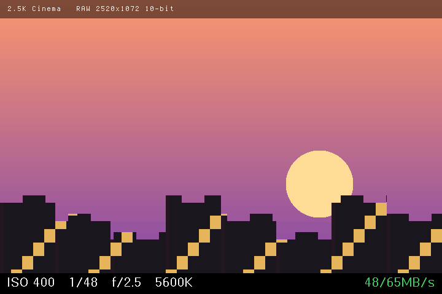
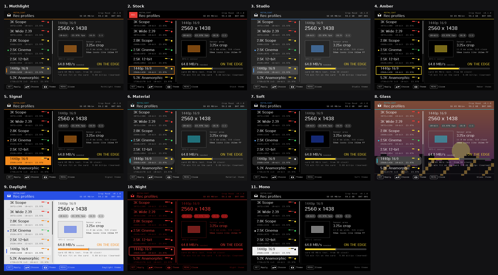

<div align="center">


# Mothlight

**Magic Lantern for the original Canon EOS M: 2.5K / 2.8K / 3K and 1x3 anamorphic RAW, with a camera UI built for it.**

by **Onur** · GPL-2.0 · firmware **2.0.2** only · not affiliated with Canon



</div>

---

Mothlight is a Magic Lantern distribution made for one camera: the 2012 **Canon EOS M**. It bundles:

- **Crop Mood**, Bilal Fakhouri's EOS M RAW engine: 1:1 crops up to **3072 x 1308** (3K), 2.8K, 2.5K,
  1440p, 1x3 anamorphic up to **5.2K**, 3x3 full-sensor 1080p and ~47-60 fps slow motion, with
  real-time preview, 10/11/12/14-bit lossless RAW, and SD card overclocking.
- **The rest of Magic Lantern**: MLV Lite RAW recording, sound, playback, dual ISO, zebras, focus
  peaking, false colour, histograms, intervalometer, file manager, Lua scripting, and more.
- **Mothlight UI** (`moth_ui`, this project's own module):
  - a full-screen, animated **recording-profile panel**. Press INFO, choose a profile, press SET.
  - a **data-rate budget** for each profile: *continuous*, *on the edge* or *burst*, based on your card's speed.
  - an animated **sensor-crop diagram**: how much of the sensor a mode uses, and what your lens becomes
    (a 50mm looks like a 135mm in 3K).
  - **learns your real compression** after every clip, so its estimates improve as you shoot.
  - a **REC tally** frame round the screen, and **11 themes** you switch live with LEFT / RIGHT.



## Install

You need an original EOS M on **firmware 2.0.2**, a fast UHS-I SD card, and 10 minutes.
**Read [docs/INSTALL.md](docs/INSTALL.md) first.** It covers backing up your card, setting the boot flag, and how to uninstall.
Canon's firmware is never replaced: one card can start as Canon or as Mothlight, chosen by holding SET
([docs/SWITCHING.md](docs/SWITCHING.md)).

1. Download `Mothlight-<version>-cropmood-<date>.zip` from [Releases](../../releases) (or build it, below).
2. Back up the card, format it **in the camera**, and unzip everything to the card's root.
3. Camera: photo mode, *Menu > Setup > Firmware Ver. 2.0.2* and run the update. This sets the boot flag; follow the screen.
4. Restart. In movie mode, press **INFO** to open the panel.

## How far does 3K go?

On the EOS M the card is the limit, not the sensor. With SD overclocking at 160 MHz (about 65 MB/s on a good card):

| Profile | RAW frame | needs | at 65 MB/s |
|---|---|---|---|
| 3K Scope | 3072x1308 10-bit 23.976 | ~72 MB/s | burst (tens of seconds) |
| 2.8K Scope | 2880x1226 10-bit 23.976 | ~63 MB/s | on the edge |
| 2.5K Cinema | 2520x1072 10-bit 23.976 | ~49 MB/s | continuous |
| 5.2K Anamorphic | 1736x2178 1x3 10-bit | ~68 MB/s | on the edge |
| 1080p Full Sensor | 1736x1160 12-bit | ~46 MB/s | continuous |

These are starting estimates (detail and ISO change them); the camera replaces them with measurements from your
own clips. More in [docs/RAW_3K.md](docs/RAW_3K.md).

## Build it yourself

Linux or WSL2 (or the Dockerfile on macOS):

```sh
scripts/setup.sh          # ARM toolchain + Python bits (Ubuntu / Debian / WSL)
scripts/fetch.sh          # pinned Crop Mood engine into work/, with our patches
scripts/build.sh          # -> out/cropmood/Mothlight-<version>-cropmood-<date>.zip
make -C sim test preview  # unit tests + PNG/GIF previews of the UI, on your PC
```

`scripts/build.sh upstream` builds on the newest Magic Lantern core (`magiclantern_simplified`) instead. It has
basic crop modes only for now. See [docs/ARCHITECTURE.md](docs/ARCHITECTURE.md) for how it all fits together.

## Your own profiles

Put a `PROFILES.TXT` in `ML/SETTINGS/` on the card:

```
# name          | mode | preset | ratio | fps    | bits
Night 2.8K      | 1:1  | 2.8K   | 2.39  | 23.976 | 10
Wide anamorphic | 1x3  | highest| 2.35  | 23.976 | 12
Canon           | off  |        |       |        |
```

Format and every option: [docs/PROFILES.md](docs/PROFILES.md).

## Safety

Magic Lantern runs from the card, alongside Canon's firmware; it doesn't replace it. Still, it is unofficial
software that drives the hardware beyond what Canon tested. **SD overclocking can corrupt a card's data.** Use it
at your own risk; nothing here is warranted (see `LICENSE`).

## Credits

Magic Lantern and its developers (a1ex, g3gg0, names_are_hard, kitor, Walter Schulz and many more), **Bilal
Fakhouri** (Crop Mood, SD overclocking), **Danne** (years of EOS M crop_rec work), **masc and ilia3101** (MLV App),
and **HNGSeries/M-Film**, whose EOS M engineering notes shaped this project. Full list: [CREDITS.md](CREDITS.md).

## License

Code: **GPL-2.0** (`LICENSE`), like Magic Lantern. Artwork in `art/`: CC BY-NC-SA 4.0. The *Mothlight* name and
logo belong to the project: forks are welcome under their own name ([TRADEMARKS.md](TRADEMARKS.md)).
